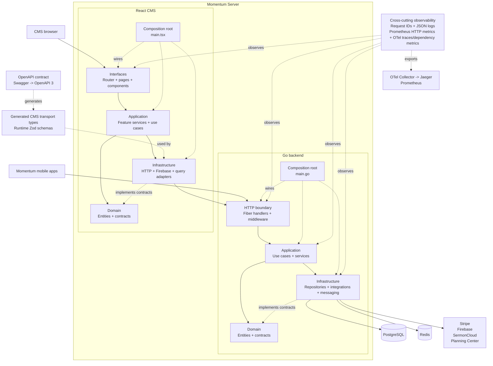

### `Momentum Server`

<b>`LIVE`</b>

https://services.momentumchurch.dev/

<b>`CMS (Typescript + React)`</b>

https://services.momentumchurch.dev/dashboard

----

Momentum Server is a Fiber API for the Momentum mobile apps and CMS. It
provides User, Meals, Sermons, Payments, Transactions, Messaging, Notifications,
Events, and Volunteer Services functionality.

The backend uses PostgreSQL with `pgx`/`sqlx` and Goose migrations, Stripe for
payments, and Redis for caching. Every `/api/v1` route requires bearer-token
authentication. API errors use a consistent JSON response with `code`, `error`,
`message`, and `requestId` fields.

-----

- #### `Go` Dependencies
  - PostgreSQL via `pgx`/`sqlx`
  - Goose for database migrations
  - Redis for caching
  - Fiber
  - Stripe
  - Firebase

- #### `Typescript` Dependencies
  - React
  - TanStack Query
  - TailwindCSS
  - React Router
  - Flowbite React
  - Firebase Authentication

The React CMS is exposed by the backend, and React Router is used for in-app
routing. The backend serves each CMS route and React Router maps the route to
its corresponding page.

The CMS compiler uses TypeScript 7. `@typescript/typescript6` is kept as the
compatibility API for tools that have not added TypeScript 7 support yet.

The CMS follows the same dependency boundaries as the backend:

- `domain/` contains entities and contracts.
- `application/` contains feature services and use cases.
- `infrastructure/` contains HTTP, authentication, and query adapters.
- `interfaces/` contains the React presentation layer.
- `main.tsx` is the CMS composition root, analogous to `main.go`.

## Architecture

### Backend

```text
main.go
├── domain/                         Entities and repository contracts
├── application/                   Use cases, services, configuration, cache
└── infrastructure/
    ├── http/                      Fiber handlers and middleware
    ├── integration/               Stripe, SermonCloud, Planning Center
    ├── messaging/                 Email and Firebase messaging
    └── persistence/               PostgreSQL, Redis, repositories, migrations
```

### CMS

```text
cms/src/
├── domain/                        Entities and repository contracts
├── application/                   Feature services and use cases
├── infrastructure/               HTTP, Firebase, and query adapters
├── interfaces/                    Router, providers, pages, and components
└── main.tsx                       Composition root
```

### Architecture at a glance

Solid arrows show request and runtime flow. Dashed arrows show dependency,
implementation, composition-root, and observability relationships.



Observability is cross-cutting rather than a dependency layer. Every request
gets a request ID and structured JSON log fields. Fiber Prometheus exposes
bounded HTTP metrics at the protected `/metrics` endpoint. OpenTelemetry
records Fiber and application-service traces, PostgreSQL spans, Redis spans,
and outbound HTTP spans. When `OTEL_EXPORTER_OTLP_ENDPOINT` is configured,
traces and dependency metrics are exported through an OTLP collector; without
that setting, the API remains functional with local no-op OpenTelemetry
providers.

The health endpoints are intentionally separate from readiness:

- `GET /healthz` is a process-only liveness check.
- `GET /readyz` checks PostgreSQL and Redis and returns `503` until both are
  available.
- `GET /metrics` is a bearer-authenticated Prometheus scrape endpoint.
- Fiber Uptime is always enabled. Its bearer-authenticated dashboard is
  available at `/uptime` and stores history in Redis under a dedicated key
  prefix.

For a self-hosted Jaeger, Prometheus, and OpenTelemetry Collector stack on one
machine:

```bash
export PROMETHEUS_BEARER_TOKEN='the same value configured as API_KEY for the API'
docker compose -f docker-compose.observability.yml up -d
```

Set `OTEL_EXPORTER_OTLP_ENDPOINT=http://localhost:4317` in the API
environment. The collector scrapes the protected API metrics endpoint using
`PROMETHEUS_BEARER_TOKEN`, exports traces to Jaeger, and exposes collector
metrics for Prometheus. Keep the token in the shell environment or a local
secret manager; do not add it to the Compose file.

This can run locally at no software cost or as one Docker Compose deployment
on a single VPS/server for one infrastructure bill. The API, OpenTelemetry
Collector, Jaeger, and Prometheus remain separate containers for operational
isolation, but they do not require separate hosted monitoring subscriptions.

Grafana is included as the consolidated dashboard. It is provisioned with
Prometheus and Jaeger data sources plus a Momentum API overview dashboard.
For local access, set `GRAFANA_ADMIN_PASSWORD` and start the local override:

```bash
docker compose \
  -f docker-compose.observability.yml \
  -f docker-compose.observability.local.yml \
  up -d
```

Then open `http://localhost:3000`. Jaeger is also available locally at
`http://localhost:16686`. Use Grafana panels for traffic, errors, and latency;
use Grafana Explore with the Jaeger data source for individual trace
waterfalls.

### Production reverse proxy

Production can add [Caddy](https://caddyserver.com/) as the public edge
container. Caddy provides free automatic HTTPS, protects `/uptime` with
browser-compatible Basic Auth, and keeps the API container private on the
Docker network. The Fiber bearer check for Uptime is disabled only when the
service is bound to loopback for local development or when Caddy becomes the
authentication boundary in production. Keep the bearer check enabled if the
development server is exposed beyond the local machine.

Generate a password hash for the Caddy credentials:

```bash
docker run --rm caddy:2.10-alpine \
  caddy hash-password --plaintext 'replace-with-an-operations-password'
```

Set these values in the shell or a local deployment environment:

```bash
export DOMAIN=services.example.com
export UPTIME_USERNAME=operations
export UPTIME_PASSWORD_HASH='replace-with-the-generated-caddy-hash'
export PROMETHEUS_BEARER_TOKEN='the API_KEY value used by the collector'
export GRAFANA_ADMIN_PASSWORD='replace-with-a-grafana-admin-password'
```

Start the API, Caddy, and observability containers together:

```bash
docker compose \
  -f docker-compose.observability.yml \
  -f docker-compose.production.yml \
  up -d --build
```

The public proxy serves the CMS and API, `/uptime` requires the Caddy
operations credentials, and `/metrics` is not exposed through Caddy. Grafana
is available at `https://grafana.services.example.com` behind the same Caddy
operations credentials and its own Grafana login. Jaeger is available at
`https://services.example.com:16686` through the same Caddy credentials. Allow
TCP port `16686` through the VPS firewall if you use the direct Jaeger
endpoint. The collector reaches `/metrics` privately over the Docker network;
Prometheus remains private.

### Architecture style

Momentum Server is a **modular monolith** built with **Clean Architecture**
and **Ports and Adapters** principles. The Go API and React CMS live in the
same repository and are composed as one product, while their feature modules
keep responsibilities separated.

- **Interfaces** translate HTTP requests and user interactions into
  application calls.
- **Application services** coordinate use cases and business workflows.
- **Domain** contains business entities and contracts without database,
  framework, or vendor dependencies.
- **Infrastructure** implements those contracts with PostgreSQL, Redis, and
  external integrations such as Stripe and Firebase.
- **Composition roots** (`main.go` and `main.tsx`) wire implementations into
  the application.

At runtime, requests flow from the clients through interfaces and application
services to infrastructure adapters. Dependencies point inward toward the
domain, while observability follows the entire runtime path.

The API contract is generated from the Go backend and shared with the CMS:

```text
Go DTOs and handler annotations
    -> Swagger and OpenAPI 3
    -> Generated TypeScript transport types
    -> Generated runtime Zod schemas
```

----

### Database (Neon Postgres)

The application uses PostgreSQL connection settings from `DATABASE_URL`.

- Set `DATABASE_URL` to your PostgreSQL connection URL.
- Goose migrations run automatically during application startup.
- Migration files live in `infrastructure/persistence/db/migrations`.

### Application configuration

Copy the committed environment template for local development:

```bash
cp .env.example .env
```

Replace the placeholders with your local values. See
[`.env.example`](./.env.example) for the complete list of settings.


Never commit real credentials.

### Developer commands

The root `Makefile` provides the common local workflows:

```bash
make help
make run
make build
make test
make test-postgres
make swagger
make openapi
make openapi-check
make cms-api-types
make cms-api-types-check
make cms-api-schemas
make cms-api-schemas-check
make fmt
make check
make docker-build
```

The Go handler annotations remain the source of API documentation. `make
openapi` regenerates the Swagger 2.0 files used by the existing Swagger UI and
converts the same generated contract into the validated OpenAPI 3 document at
[`docs/openapi.json`](./docs/openapi.json). The OpenAPI document is generated,
not manually edited, and is the source for generated CMS transport types and
runtime Zod schemas.

JSON request handlers use a shared request binder and validator before calling
application services. It rejects malformed JSON and missing DTO fields marked
with `binding:"required"` while preserving explicit zero and false values.

GitHub Actions runs `go test ./...`, verifies Go modules, and runs
`make openapi-check` so generated API documents cannot drift from the Go
annotations and DTOs. It also verifies generated CMS transport types, lints
the CMS runtime schemas and transport types, lints the CMS, and builds the
production frontend.

Build the CMS before starting the Go server:

```bash
cd cms
yarn install --frozen-lockfile
yarn lint
yarn build
cd ..
make run
```

`make run` is the normal local development workflow. It runs the Go API
directly on the host and expects the required values from `.env`, including
the local or separately hosted PostgreSQL and Redis URLs.

The local dashboard is served at:

http://localhost:8080/dashboard

For CMS development, `yarn dev` watches the frontend build output. The Go
server continues to serve the generated files from `cms/dist`.

### PostgreSQL integration tests

The repository integration tests can run against an ephemeral PostgreSQL
container:

```bash
make test-postgres
```

The script starts PostgreSQL on `127.0.0.1:55432`, runs the Goose migrations and
repository integration tests, then removes the container and its temporary
volume.

----

### [API Documentation](https://services.momentumchurch.dev/swagger/index.html)

The API provides users and the CMS with access to create, edit, retrieve, and
upload content.

Each `/api/v1` route requires a bearer token.

-----

### [Users](https://services.momentumchurch.dev/swagger/index.html#/Users)

Users are allowed to create accounts, retrieve, update, and delete their
information.

------

#### [Get User By Id](https://services.momentumchurch.dev/swagger/index.html#/Users/get_api_v1_users__userId_)

This endpoint allows users to get their own information.


------

#### [Post a User](https://services.momentumchurch.dev/swagger/index.html#/Users/post_api_v1_users)

This endpoint allows users to post user information.


------

#### [Update a User](https://services.momentumchurch.dev/swagger/index.html#/Users/put_api_v1_users)

This endpoint allows users to update their own information.


------

#### [Delete a User](https://services.momentumchurch.dev/swagger/index.html#/Users/delete_api_v1_users__userId_)

This endpoint allows users to delete their own information.


-----

### [Transactions](https://services.momentumchurch.dev/swagger/index.html#/Transactions)

Users are allowed to create transactions after making a payment, then view and
delete their transactions.

------

#### [Post a Transaction](https://services.momentumchurch.dev/swagger/index.html#/Transactions/post_api_v1_transactions)

This endpoint allows users to post a transaction.


------

#### [Delete a Transaction](https://services.momentumchurch.dev/swagger/index.html#/Transactions/delete_api_v1_transactions__transactionId_)

This endpoint allows users to delete a transaction.


------

#### [Get User Transactions](https://services.momentumchurch.dev/swagger/index.html#/Transactions/get_api_v1_transactions__userId_)

This endpoint allows users to get their own transactions.


-----

### [Meals](https://services.momentumchurch.dev/swagger/index.html#/Meals)

Users are allowed to organize meals. A meal contains the receiver's contact,
food preferences, allergies, dates to send the meals, and volunteers to bring
the meals.

-----

#### [Get All Meals](https://services.momentumchurch.dev/swagger/index.html#/Meals/get_api_v1_meals)

This endpoint allows users to fetch all meals available.


-----

#### [Post a Meal](https://services.momentumchurch.dev/swagger/index.html#/Meals/post_api_v1_meals)

This endpoint allows users to post a meal.


------

#### [Post a Meal Participant](https://services.momentumchurch.dev/swagger/index.html#/Meals/post_api_v1_meals_meal)

This endpoint allows users to volunteer as a participant in a meal.


------

### [Sermons](https://services.momentumchurch.dev/swagger/index.html#/Sermons)

Users are allowed to view sermons. They contain preacher and video playback
metadata.

------

#### [Get Sermons By Page #](https://services.momentumchurch.dev/swagger/index.html#/Sermons/get_api_v1_sermons)

This endpoint allows users to get sermons.


-----

### [Payments](https://services.momentumchurch.dev/swagger/index.html#/Payments)

Users are allowed to post payment information to initiate Stripe checkout.

------

#### [Post a Payment](https://services.momentumchurch.dev/swagger/index.html#/Payments/post_api_v1_payments)

This endpoint allows users to post payments.


-----

### [Messages](https://services.momentumchurch.dev/swagger/index.html#/Messages)

The CMS uses these endpoints to manage published and staged messages:

```text
GET  /api/v1/messages/admin
GET  /api/v1/messages/unpublished
POST /api/v1/messages
PUT  /api/v1/messages
```

The CMS routes are:

```text
/dashboard
/messages
/notifications
/payments
/users
```

## Production build

The multi-stage [Dockerfile](./Dockerfile) installs the CMS dependencies,
builds the React assets, copies `cms/dist` into the Go image, and compiles the
single production binary into a minimal non-root runtime image. The image
includes the `/healthz` container health check and listens on port `8080` by
default.

```bash
make docker-build
docker run --env-file .env -p 8080:8080 momentum-server
```

The generated CMS `dist` directory is intentionally ignored by Git and created
during the Docker build.
